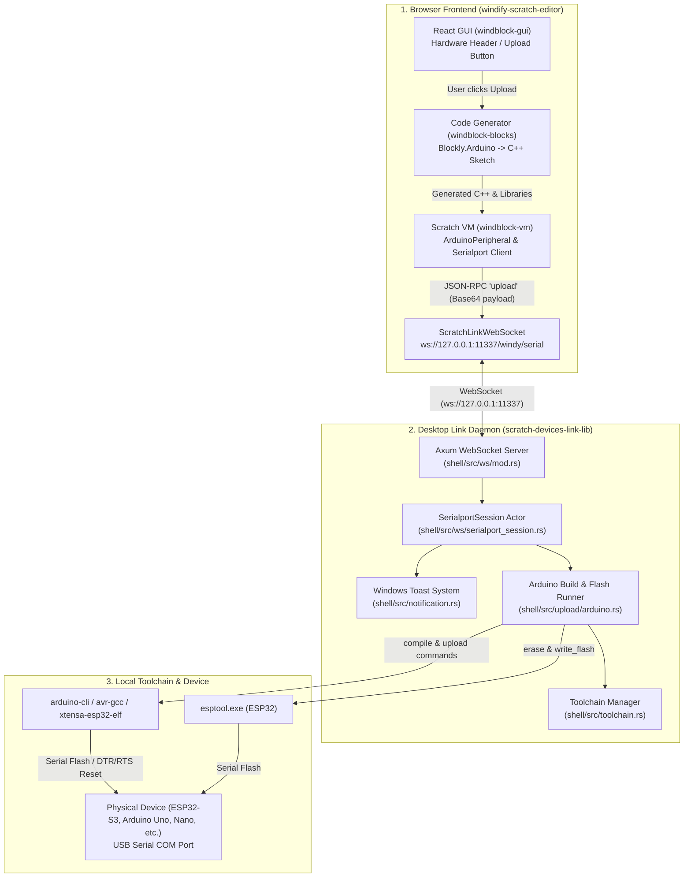

# Future Academy Link

Local hardware link server for [Future Academy](https://stem.windify.edu.vn/).

Single Rust binary — no Node.js or Electron at runtime. Downloads arduino-cli and ESP32 toolchain on first launch when no local toolchain is present.

---

## Install

Download the latest release for your platform from the [Releases](../../releases) page:

| File | Platform |
|------|----------|
| `Future Academy Link.app` | macOS Apple Silicon |
| `Future Academy Link — Intel.app` | macOS Intel |
| `Future Academy Link.exe` | Windows x64 |


---

## Build locally

Prerequisites: Rust (via rustup).

```bash
# Build shell (Windows)
./shell/scripts/build.sh --release

# Build shell (macOS Apple Silicon)
./shell/scripts/build.sh --release --target aarch64-apple-darwin

# Build shell (macOS Intel)
./shell/scripts/build.sh --release --target x86_64-apple-darwin

# Package for Windows distribution
./shell/scripts/package-win.sh

# Build installer (requires Inno Setup 6)
./shell/scripts/build-setup.sh
```

Cross-compile targets require rustup:
```bash
rustup target add aarch64-apple-darwin
rustup target add x86_64-apple-darwin
rustup target add x86_64-pc-windows-gnu
```

### Toolchain management
```bash
# Download arduino-cli and ESP32 toolchain
./shell/scripts/download-tools.sh

# Prune unused tools (dry run)
./shell/scripts/prune-tools.sh

# Prune unused tools (apply)
./shell/scripts/prune-tools.sh --apply

# Archive tools for distribution
./shell/scripts/archive-tools.sh --overwrite

# Extract tools from archive
./shell/scripts/extract-7z.sh <path-to-tools.7z>
```

### Build workflow
```bash
# Full build: download tools, prune, archive, package
./shell/scripts/download-tools.sh
./shell/scripts/prune-tools.sh --apply
./shell/scripts/clean-dist.sh
./shell/scripts/prepare-installer-payload.sh
./shell/scripts/package-win.sh
./shell/scripts/build-setup.sh
```

---

## How it works

- `FutureAcademy` starts a tray icon and an embedded HTTP/WebSocket server on `http://127.0.0.1:11337`
- Serial devices appear in the tray menu in real time
- Tray shows setup progress while tools download on first run
- Logs are written to stderr. `FutureAcademy` is built as a Windows GUI subsystem app, so to see live logs you must launch it from a terminal:
  - **Windows (cmd):** `FutureAcademy.exe` — lines appear in the same console; redirect with `FutureAcademy.exe > link.out 2>&1` to capture.
  - **Windows (PowerShell):** `& '.\FutureAcademy.exe'` — redirect with `& '.\FutureAcademy.exe' 2>&1 | Tee-Object link.out`.
  - **macOS / Linux:** run the binary directly from Terminal.app / iTerm2 / your shell.

---

## JSON-RPC API (WebSocket)

Connect to `ws://127.0.0.1:11337/`. All messages are JSON-RPC 2.0.

### `connect`
```jsonc
{ "jsonrpc": "2.0", "id": 1, "method": "connect", "params": { "port": "/dev/cu.usbmodem123", "baudRate": 115200 } }
```

### `upload` (Arduino AVR)
```jsonc
{ "jsonrpc": "2.0", "id": 2, "method": "upload", "params": { "port": "/dev/cu.usbmodem123", "board": "uno", "hex": "<base64>" } }
```

### `uploadEsp32Bin`
```jsonc
{
  "jsonrpc": "2.0", "id": 3, "method": "uploadEsp32Bin",
  "params": {
    "chip": "esp32s3", "baudrate": 921600,
    "addresses": { "bootloader": 0, "partitions": 32768, "firmware": 65536 },
    "bins": {
      "bootloader": { "encoding": "base64", "data": "<...>" },
      "partitions":  { "encoding": "base64", "data": "<...>" },
      "firmware":    { "encoding": "base64", "data": "<...>" }
    }
  }
}
```

Progress streams via `uploadStdout` notifications. Ends with `uploadSuccess`.

### `scanDevices`
```jsonc
{ "jsonrpc": "2.0", "id": 4, "method": "scanDevices", "params": { "command": "scan", "terminator": "\n", "timeoutMs": 10000 } }
```

Returns `{ devices: [...], raw: "..." }`.

---

## CI / Releases

Pushing to `main` or `dev` triggers a build for all 3 platforms. A successful
`main` build publishes a GitHub release tagged `v{version}` (from
`shell/Cargo.toml`). Zips are created on the native runner (`ditto` for macOS,
`Compress-Archive` for Windows) to preserve permissions.

Every release requires a new stable semantic version. Update
`shell/Cargo.toml`. CI permits a retry when the existing tag
points to the same commit, but refuses to move a tag from another commit.

